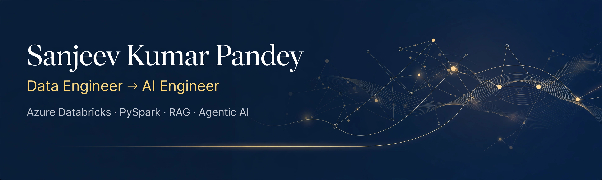

I build reliable data platforms on Azure — and the AI systems that sit on top of them. Ingestion and modelling in Databricks, streaming and batch pipelines in production, and RAG / LLM applications grounded in that same data, with traceable sources.

📍 India — On-site · Hybrid · Remote · Open to Data / AI Engineering roles · 3+ years

[LinkedIn](https://www.linkedin.com/in/sanjeev-pandey-7a45831ba) · [GitHub](https://github.com/sanjeevpandeydata) · [Portfolio](https://sanjeevpandeydata.github.io/)

---

## About

My focus is where data engineering meets GenAI: **Unity Catalog, Delta Lake, vector search, and agentic workflows on one platform.**

**Currently focused on**

- Disaster recovery for Unity Catalog — metadata, data, and grants rebuilt idempotently in a DR workspace
- Grounded RAG over unstructured documents, with citations a reader can verify
- Production PySpark: performance, cost, and reliability, not just pipelines that run once

---

## Featured Work

### [Unity Catalog DR Sync](https://github.com/sanjeevpandeydata/unity-catalog-dr-sync)

Disaster recovery for Unity Catalog: two workflows, six notebooks that recreate credentials, external locations, catalogs, and schemas in a DR workspace, then sync data, volumes, and views, and apply grants.

*Metadata skeleton first, then DEEP CLONE data and delta-only grants. CSV-driven, no hardcoded names or secrets.*

`Unity Catalog` `Databricks` `DEEP CLONE` `REST API`

### [Azure ETL Pipeline](https://github.com/sanjeevpandeydata/azure-etl-pipeline)

Scalable ELT pipeline for CRM data, using Azure Data Factory + Databricks and Medallion architecture.

*50M+ records/month. Data availability **T+2 days → under 4 hours**, runtime **2 hours → 35 minutes**, ~40% compute cost reduction.*

`Azure Data Factory` `Databricks` `Delta Lake` `Medallion`

### [Event Hub Streaming Pipeline](https://github.com/sanjeevpandeydata/eventhub-streaming-pipeline)

Real-time streaming ingestion on Databricks, consuming Avro messages from Azure Event Hubs with Structured Streaming and Auto Loader.

*Dynamic schemas, JSON validation, ROW_NUMBER deduplication, and idempotent MERGE upserts for at-least-once delivery.*

`Structured Streaming` `Auto Loader` `Avro` `Delta Lake`

### [Delta Lake to MySQL Data Copy](https://github.com/sanjeevpandeydata/delta-to-mysql-datacopy)

Copies a leads report table from Delta Lake to MySQL in full-reload and daily modes, replacing driver-side `collect()` + `executemany()` with distributed `mapInPandas` inserts and a JDBC anti-join for dedup.

*Parallel inserts across executors with per-partition MySQL connections; serverless-compatible, with no driver bottleneck.*

`PySpark` `mapInPandas` `JDBC` `MySQL`

### [Spark Performance & Cost Optimisation](https://github.com/sanjeevpandeydata/spark-performance-optimization)

Measured benchmark for Spark layout optimisation: partitioning, Z-ordering with `OPTIMIZE`, and broadcast joins on a synthetic sales dataset, with the same queries run unchanged against each layout.

*Median of repeated runs, with files touched recorded; no result claimed until run on Databricks.*

`PySpark` `Delta Lake` `Z-Ordering` `Broadcast Join`

### [NewsVault AI](https://github.com/sanjeevpandeydata/newsvault-ai)

Newspaper intelligence & RAG on Databricks Free Edition: spatial article reconstruction, article-aware chunking, embeddings, Vector Search, and grounded answers with citations.

*Phases 1–9 verified on 2 newspaper PDFs; daily pipeline built, app held.*

`Databricks` `RAG` `Vector Search` `Llama 3.3`

### [CDC + SCD Type 2 Lakehouse](https://github.com/sanjeevpandeydata/cdc-scd2-lakehouse)

Change-data-capture platform on Databricks: streams database changes into a Delta Lakehouse with full SCD Type 2 history, exactly-once ingestion, watermark quarantine for late events, and a reconciliation report on every run.

*Duplicate deliveries deduplicated, deletes close versions instead of erasing history; syntax-checked on synthetic data, no result claimed until run on Databricks.*

`PySpark` `Delta Lake` `CDC` `SCD Type 2` `Reconciliation`

---

## Tech Stack

| Area | Tools |
|---|---|
| Cloud & Data Platform | Azure · Databricks · Unity Catalog · Delta Lake · ADLS Gen2 · Azure Data Factory · Azure Event Hubs |
| Data Engineering | PySpark · Spark SQL · SQL · Python |
| AI / GenAI | RAG · LLMs · Agentic AI · Vector Search · Prompt Engineering |

---

## Let's connect

- [LinkedIn — Sanjeev Pandey](https://www.linkedin.com/in/sanjeev-pandey-7a45831ba)
- [GitHub — sanjeevpandeydata](https://github.com/sanjeevpandeydata)
- [Portfolio](https://sanjeevpandeydata.github.io/)

*Open to Data / AI Engineering roles in India — On-site · Hybrid · Remote — where data engineering meets GenAI.*

**B.Tech, Computer Science Engineering** · Oriental Group of Institutes, 2019–2023
